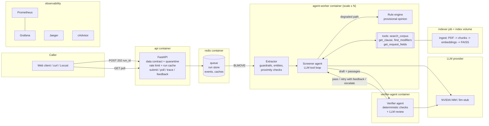

# Environmental Clearance Pre-Screening Service

UE24AM342AA5 ML System Design and AgentOps · Mini Project 13 · Jackfruit (Level 3)

Given a project description, the service says whether the project needs prior environmental
clearance under India's **EIA Notification 2006**, and if so whether it is **Category A**
(appraised by the Central Government) or **Category B** (appraised by the State), citing the
provisions it relied on. When the evidence does not settle the question, it **escalates to a
human** instead of answering. It produces a screening opinion, never a clearance decision.

The hard part (PS §4.1): a Schedule row can say Category B while the **General Condition**,
printed after the Schedule, moves the same project to Category A because it sits within 5 km of
a national park. A search on the project type never returns the General Condition. Here, a
Screener agent reads the row, follows the row's own "General Condition shall apply" reference
with a tool, and a separate Verifier agent refuses any draft that ignores it.

---

## 1. Run it (clean clone, Docker)

Requirements: Docker Desktop (or Docker Engine with Compose v2.24+), about 6 GB free disk, internet
for the first build. **No API key is needed**: by default a stub LLM answers.

```bash
git clone https://github.com/pallaviB463/Environmental-Clearance-MLOps.git
cd Environmental-Clearance-MLOps
docker compose up --build
```

The first start takes several minutes: it builds the image, then the `indexer` service parses the
corpus PDFs, embeds them and builds the FAISS index (about a minute). Everything else waits for it.
It is ready when `docker compose ps` shows `api` as healthy.

| What | Where |
|---|---|
| Web client (submit a project, see the result, citations, escalation path) | http://localhost:8000 |
| API docs (OpenAPI) | http://localhost:8000/docs |
| Grafana dashboard | http://localhost:3000 |
| Jaeger traces | http://localhost:16686 |
| Prometheus | http://localhost:9090 |

Try the PS §4.1 case from the command line:

```bash
curl -s -X POST localhost:8000/v1/screenings -H 'content-type: application/json' -d '{
  "description": "Integrated cement plant of 0.8 MTPA located 2.0 km from the boundary of Gir National Park.",
  "sector_hint": "cement",
  "capacity": {"value": 0.8, "unit": "million_tonnes_per_annum"},
  "location": {"state": "Gujarat", "district": "Gir Somnath"},
  "proximity": [{"feature": "protected_area", "subtype": "national_park", "distance_km": 2.0, "basis": "surveyed"}]
}'
# -> {"run_id": "run_...", "status": "queued", "poll_url": "/v1/screenings/run_..."}
curl -s localhost:8000/v1/screenings/<run_id>          # poll until status is answered / escalated
curl -s localhost:8000/v1/screenings/<run_id>/trace    # every tool call, passage, prompt version, cost
```

Scale the agent workers (A7): `docker compose up -d --scale agent-worker=3`.
Per-container resource metrics from cAdvisor (optional, Linux hosts):
`docker compose --profile cadvisor up -d`.
Stop: `docker compose down` (add `-v` to also delete the index and Redis volumes).

### Use a real LLM (NVIDIA NIM free tier)

```bash
cp .env.example .env
# edit .env:
#   LLM_PROVIDER=nvidia
#   LLM_BASE_URL=https://integrate.api.nvidia.com/v1
#   LLM_API_KEY=nvapi-...            (build.nvidia.com -> any model -> "Get API Key")
#   LLM_MODEL=nvidia/nemotron-3-super-120b-a12b
#   LLM_FALLBACK_MODEL=openai/gpt-oss-20b
docker compose up -d --build
```
Any OpenAI-compatible endpoint works; the provider is chosen only by configuration.

## 2. Run it without Docker (single process)

```bash
python3.11 -m venv .venv && source .venv/bin/activate
pip install --index-url https://download.pytorch.org/whl/cpu torch==2.15.0
pip install -r requirements.txt
python -m ingest build                     # build the index (~1 min the first time; idempotent)
python run_local.py                        # one screening in-process, prints the trace
python -m uvicorn api.app:app --port 8000  # API + web client; runs execute in-process (no Redis)
```

## 3. Demonstration, evaluation, tests, load test

```bash
python demo.py                                   # walks through the 10 demo items of PS §9 (stack must be up)
python -m eval.run_eval                          # 28-scenario evaluation (L3), report in eval/reports/
python -m eval.run_eval --compare v1 v2          # prompt variants on the same set (L2)
python -m eval.run_eval --change no_find_modifiers   # one deliberate change, before/after (L3)
pytest -q                                        # unit + integration tests
python -m loadtest.run_sweep --label workers1    # Locust sweep vs the declared SLO (D6), stack must be up
```

Run evaluations with the real LLM configured; with the stub, the "model" is the rule engine and
the numbers only prove that the harness works.

---

## 4. How it works



**One run:** the API validates the request against the published contract (a malformed one is
quarantined with its field errors and never starts a run), stores the run in Redis, queues it and
returns `202` with a run id. A worker takes it from the queue. The **Extractor** runs the input
guardrails and pulls out sector, capacity and distances; an injection attempt or an uncertain
distance is escalated here, before any model call. The **Screener** agent (LLM) chooses tools:
typically it searches the Schedule, reads the row, calls `find_modifiers`, which follows the
row's "General Condition shall apply" link to the General Condition, and returns a JSON draft with
citations and verbatim quotes. The **Verifier** agent (separate service) checks that every citation
was retrieved in this run, every quote is really in its passage, the route matches the category,
and that the General Condition was applied when the project is within its distance; then a second
model reviews the full cited text. A failed check goes back to the Screener with feedback (bounded
retries) or escalates. Output guardrails run last. If the provider is down, the circuit breaker
opens and the run is escalated with a rule-based provisional opinion attached, never a confident
answer.

| Design topic | Where | Notes |
|---|---|---|
| Chunking (L1) | [ingest/chunking.py](ingest/chunking.py) | One chunk per Schedule row, the General Condition as its own chunk, footnotes separate; cross-references recorded at ingestion |
| Index (L1, D2) | [ingest/pipeline.py](ingest/pipeline.py) | LangChain + FAISS + local all-MiniLM-L6-v2; incremental: only changed chunks re-embedded; manifest with freshness |
| Agents (A1, A2) | [agent/graph.py](agent/graph.py), [agent/agents/](agent/agents/) | LangGraph; Screener + Verifier with own prompts, tools, budgets |
| Verification (A3) | [agent/agents/verifier.py](agent/agents/verifier.py) | Deterministic checks + LLM review; unverified drafts are never returned |
| Resilience (A5) | [agent/llm/gateway.py](agent/llm/gateway.py) | Timeout, retry with backoff, circuit breaker per model, fallback model, degraded path |
| Prompts (L2) | [agent/prompts/](agent/prompts/) | Versioned files; version and hash recorded on every call and result |
| Guardrails (L4) | [agent/guardrails/](agent/guardrails/) | Injection and toxicity on input, output filter, data delimiters, read-only tools |
| Contract (D1) | [api/contract.py](api/contract.py) | Served at `GET /v1/contract` |
| Run trace (D5) | `GET /v1/screenings/{id}/trace` | Every tool call, query, passage id, prompt version, per-step latency, tokens, cost, verification |
| Eval (L3) | [eval/](eval/) | Metric definitions in [eval/metrics.py](eval/metrics.py) |
| SLO (D6) | [docs/SLO.md](docs/SLO.md) | p95 of a complete run ≤ 60 s |
| Runbook (D8) | [docs/RUNBOOK.md](docs/RUNBOOK.md) | Two failure modes + incident log |

Configuration is documented in [.env.example](.env.example). No credentials, endpoints or model
identifiers live in the code.

## 5. API summary

| Method | Path | Purpose |
|---|---|---|
| POST | `/v1/screenings` | Submit (202 + run id; 422 + quarantine id if invalid; 429 if rate limited) |
| GET | `/v1/screenings/{id}` | Status and result (category, route, basis, citations, verification, escalation path) |
| GET | `/v1/screenings/{id}/trace` | Full reconstruction of the run |
| POST | `/v1/screenings/{id}/feedback` | `{"satisfactory": bool, "reason": str}` |
| GET | `/v1/feedback/summary`, `/v1/quality` | Aggregated feedback; automatic scores of sampled live runs |
| GET | `/v1/contract`, `/v1/quarantine` | Published data contract; quarantined submissions |
| GET | `/health`, `/metrics` | Health; Prometheus metrics |
| POST/GET | `/admin/chaos`, `/admin/breakers` | Simulate a provider outage; circuit breaker states (demo item 8) |
