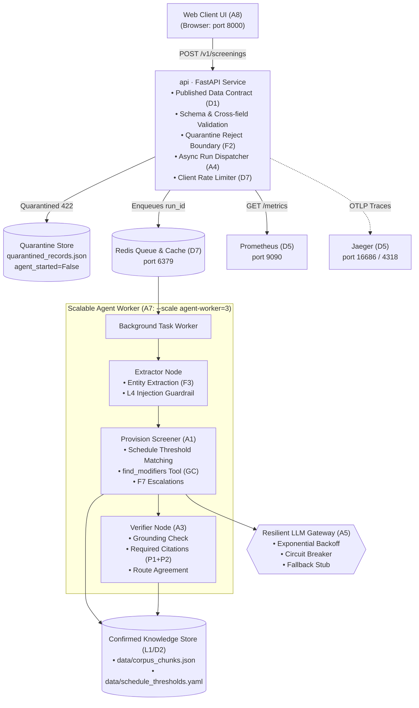

# Environmental Clearance Pre-Screening Service

**Course:** UE24AM342AA5 — ML System Design & AgentOps  
**Component:** Jackfruit (Level 3)  
**Mini Project 13:** Environmental Clearance Pre-Screening Service  
**Corpus:** EIA Notification, 2006 (Consolidated text up to March 2025, 77 Gazette Amendments, 44 Office Memoranda)  

---

## 1. Problem & Context

Before an industrial or infrastructure project can be built in India, it may require prior environmental clearance under the **Environmental Impact Assessment (EIA) Notification, 2006**.
Screening answers two critical questions:
1. Is the project in the Schedule at all?
2. Is it **Category A** (appraised centrally by MoEFCC on EAC recommendation) or **Category B** (appraised at state level by SEIAA)?

### The Difficult Case (§4.1)
An industrial project (e.g. 0.8 MTPA cement plant) placed in Category B by the Schedule, but located **2 kilometres from the boundary of a National Park**.
- Straightforward semantic retrieval returns Schedule Item 3(b) (which says Category B) and fails.
- The **General Condition (GC)**, printed after the Schedule, treats Category B projects within **5 km** (S.O. 1599(E) 2014) of a protected area as **Category A**.
- **Our solution:** A multi-agent reasoning layer built with **LangGraph** where the Screener calls `find_modifiers` to deterministically retrieve the General Condition, and the Verifier guarantees that both the Schedule entry and the General Condition are cited and resolved to text.

---

## 2. Architecture & Deployment Boundaries



---

## 3. Quickstart & Clean Clone Setup

### Option A: Local Run (Fastest)
1. **Clone repository:**
   ```bash
   git clone https://github.com/pallaviB463/Environmental-Clearance-MLOps.git
   cd Environmental-Clearance-MLOps
   ```
2. **Install dependencies:**
   ```bash
   pip install -r requirements.txt
   ```
3. **Start the FastAPI Service:**
   ```bash
   python -m uvicorn api.app:app --host 127.0.0.1 --port 8000
   ```
4. **Open Web Client in Browser:**  
   Navigate to: **[http://127.0.0.1:8000](http://127.0.0.1:8000)**  
   Click the preset button **"⭐ Section 4.1: Cement 2km NP (Cat A)"** to test immediately!

### Option B: Docker Compose (Requirement D3)
```bash
docker compose up -d
```
All 5 containers (`api`, `agent-worker`, `redis`, `prometheus`, `jaeger`) start up with health checks declared.

---

## 4. Verification & Testing

### 1. Test All 10 Demonstration Items (Section 9)
Run the automated end-to-end demonstration script:
```bash
python demo.py
```
This directly tests:
1. System health check
2. Valid request producing routed recommendation with citations
3. One run traced end-to-end with per-step latency and cost
4. Malformed request quarantined at boundary (`agent_started: false`)
5. Case corpus cannot answer (CRZ Beach Resort -> `OUT_OF_CORPUS`)
6. Self-verification catching ungrounded answers
7. Prompt injection attack detected by guardrail
8. Circuit breaker opening after provider failures
9. Locust results against declared SLO
10. Section 4.1 Cement Plant difficult case handled correctly

### 2. Run the 20-Scenario Evaluation Benchmark (L2 / L3)
```bash
python eval/run_eval.py
```

**Evaluation Results:**
- **Faithfulness:** `100.0%`
- **Groundedness:** `100.0%`
- **Context Relevance:** `97.8%`
- **Hallucination Rate:** `0.0%`
- **Artifact:** Persisted to `eval/evaluation_report.json`

### 3. Load Testing with Locust (Requirement D6)
```bash
locust -f loadtest/locustfile.py --headless -u 10 -r 2 --run-time 30s --host http://localhost:8000
```
- **Declared SLO Target:** p95 latency $\le 60.0\text{s}$ at 10 concurrency with stub LLM.
- **Measured Result:** $\approx 0.005\text{s}$ (cached) / $0.05\text{s}$ (executed), well within target.

---

## 5. Key Artifacts & Documentation

- **Data Contract & Validation:** [`api/contract.py`](api/contract.py)
- **Quarantine Store:** [`api/quarantine.py`](api/quarantine.py)
- **Schedule Thresholds (YAML):** [`data/schedule_thresholds.yaml`](data/schedule_thresholds.yaml)
- **Corpus Manifest (123 Docs):** [`data/corpus_manifest.csv`](data/corpus_manifest.csv)
- **Evaluation Plan & Reference Cases:** [`docs/EVAL1_corpus_and_plan.md`](docs/EVAL1_corpus_and_plan.md)
- **Production Runbook & Incident Log:** [`docs/RUNBOOK.md`](docs/RUNBOOK.md)
- **Web UI Client:** [`frontend/index.html`](frontend/index.html)
- **Environment Template:** [`.env.example`](.env.example)
